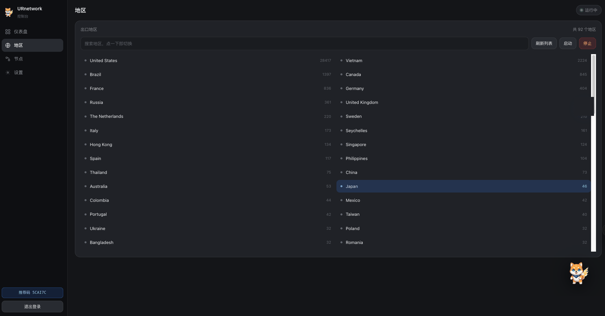
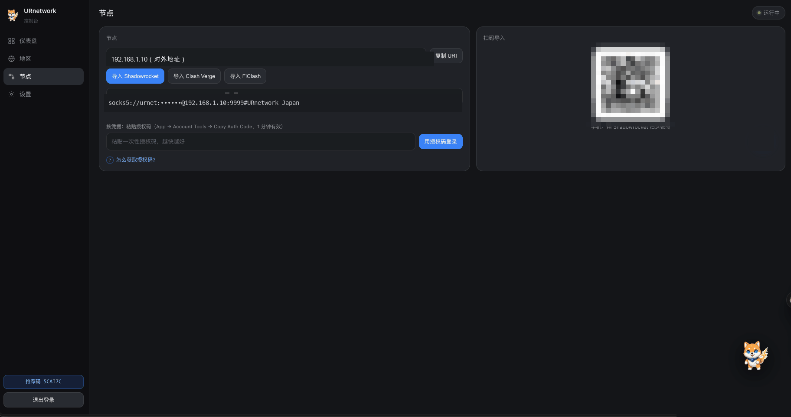

# URnetwork 面板（urnetd）

把 [URnetwork](https://ur.io/) 的去中心化出口桥接成本地 SOCKS5，并给你一个网页面板来切换地区、生成节点、导入 Shadowrocket。


> 一个本地入口，背后是几万个随机出口；分流规则仍然在你自己的客户端里配。

## 下载

安装包在 [Releases](https://github.com/jiema123/URnetworkProxy/releases/latest) 里（不放进 git 历史，避免仓库被几十 MB 的二进制撑大）：

| 平台 | 文件 |
| --- | --- |
| macOS（Intel + Apple Silicon 通用） | `urnetd-x.y.z.dmg` |
| Linux amd64 | `urnetd-linux-amd64.tar.gz` |
| Linux arm64 | `urnetd-linux-arm64.tar.gz` |
| Windows x64 | `urnetd-windows-amd64.zip` |

---

## 为什么需要它

URnetwork 是 P2P 网络：出口是你家宽带上的**真人设备**，地址随机、随时变化，
所以它给不出「节点列表」——你没法把 `IP:端口 + 密码` 填进 Shadowrocket / Clash / sing-box。

可行做法只有一个：在本机跑一个桥接进程，让它**对外只暴露一个 SOCKS5 端口**，
出口由平台按你选的地区实时分配。这个面板就是管这个桥接进程的。

| 常见误解 | 实际情况 |
| --- | --- |
| 面板里是一堆可选节点 | 只是一个入口 + 一个地区条件 |
| 切换地区 = 换个节点 | 是重启桥接进程，让平台重新挑出口 |
| 换 IP 要改配置 | 每次建连都可能是新出口，端口和账号不变 |

## 架构


- **出口层**：URnetwork 平台按地区挑出真实设备做出口，随机且会变
- **桥接层**：`socksproxy` 子进程（官方 `urnetwork/proxy` 的 socks 实现），负责把 SOCKS5 流量送进 P2P 网络
- **客户端层**：Shadowrocket / Clash 把本机端口当成普通 SOCKS5 节点用，分流规则在这里配

面板（`urnetd`）本身不转发流量，它只做四件事：管进程、切地区、探真实出口、发节点。

## 功能

- **网页面板**：点地区即切换，失败自动回滚到上一个地区
- **真实出口探测**：内置极简 SOCKS5 客户端（RFC1929），走代理查 `ipinfo.io`，显示出口 IP / 城市 / 耗时
- **节点分发**：生成节点 URI 和二维码；macOS 上可以把节点一键推进 Shadowrocket，也可以推进 Clash Verge / FlClash（走订阅地址）
- **授权码登录**：App 里点一下 Copy Auth Code，粘到面板就换到新凭据，不用找密码、不用拷文件
- **面板密码**：加盐 SHA-256 ×10 万轮存储，会话用 HMAC 签名，改密码即让旧会话失效
- **开机自启**：macOS 用 LaunchAgent，Linux 用 systemd user unit，一个命令装/卸
- **真·单文件**：Go 标准库 + 一个纯 Go 二维码库，前端内嵌，无打包步骤；macOS 出通用二进制（Intel + Apple Silicon）

## 快速开始

### macOS（dmg）

1. 从 [Releases](https://github.com/jiema123/URnetworkProxy/releases/latest) 下载 `urnetd-x.y.z.dmg`，把 **URnetwork Console.app** 拖进「应用程序」
2. 首次打开要绕过 Gatekeeper（无 Apple 开发者签名）：右键 app →「打开」→ 再点「打开」
3. 它会起服务并打开浏览器（默认 `http://127.0.0.1:8877`），**第一次会引导你设一个面板密码**
4. 到面板里粘授权码、选地区、扫码导入节点

app 是纯后台服务（`LSUIElement`），没有 Dock 图标也没有菜单栏图标。想再打开面板：

- 双击 dmg 里的 **打开控制台.command**
- 或者浏览器收藏 `http://127.0.0.1:8877`
- 或者再双击一次 app —— 检测到已在运行会直接打开面板

### Linux（tar.gz）

从 [Releases](https://github.com/jiema123/URnetworkProxy/releases/latest) 下载对应架构的包：

```bash
sudo mkdir -p /opt/urnetd
sudo tar -xzf urnetd-linux-arm64.tar.gz -C /opt/urnetd
sudo chmod +x /opt/urnetd/urnetd /opt/urnetd/socksproxy

/opt/urnetd/urnetd              # 前台跑，默认 http://127.0.0.1:8877
/opt/urnetd/urnetd install      # 装 systemd user unit 并立即启动
```

服务器场景（面板要监听对外地址时）必须先设密码，因为网页端不能自助设置：

```bash
/opt/urnetd/urnetd set-password '你的密码'
URNETD_LISTEN=0.0.0.0:8877 /opt/urnetd/urnetd
sudo loginctl enable-linger $USER   # 没登录会话也让服务常驻
```

### Windows（zip）

1. 解压到任意目录（例如 `D:\urnetd`），**两个 exe 必须放在同一个文件夹**
2. 双击 `1-start.bat`（或直接双击 `urnetd.exe`）；出现 SmartScreen 提示就点「更多信息 → 仍要运行」
3. 它会起服务并打开浏览器（`http://127.0.0.1:8877`），第一次会让你设面板密码
4. 拿授权码粘到面板「节点 → 换凭据」里

包里还带了几个小工具（都是双击即用）：

| 文件 | 作用 |
| --- | --- |
| `1-start.bat` | 启动服务并打开面板，先帮你检查两个 exe 在不在 |
| `2-fix-path.bat` | 两个 exe 放散了？双击它自动找回 `socksproxy.exe` 并放到一起 |
| `3-install-autostart.bat` | 写注册表 Run 项，登录后自动启动 |
| `4-uninstall-autostart.bat` | 移除自启 |
| `5-diagnose.bat` | 出问题时双击：打印目录、端口占用和启动日志 |

命令行等价写法：`urnetd.exe install` / `urnetd.exe uninstall`。
`urnetd` 会按「同目录 → app 包 Resources → PATH」的顺序找 `socksproxy.exe`，
也可以用 `URNET_BIN` 指定绝对路径。

Windows 上没有 Shadowrocket，用 Clash Verge / FlClash，面板里点对应按钮就能导入。

### 从源码构建

```bash
go build -o urnetd .          # 需要 Go 1.27+
./urnetd
```

三个平台都是纯 Go，交叉编译即可：

```bash
CGO_ENABLED=0 GOOS=windows GOARCH=amd64 go build -o urnetd.exe .
CGO_ENABLED=0 GOOS=linux   GOARCH=arm64 go build -o urnetd .
```

打包（产物在 `dist/`、`linux/`）：

```bash
./package-macos.sh     # 出 .app + dmg，两个二进制都是 arm64+x86_64
./package-linux.sh     # 出 amd64 / arm64 tar.gz
./package-windows.sh   # 出 windows-amd64 zip
./release.sh 1.1.0     # 打包三平台 + 打 tag + 发 Release
```

## 第一次用：拿授权码

面板要的是 URnetwork 的凭据（JWT），它不是密码，只能由官方登录签发。
最省事的做法是拿一次性授权码换：


1. 浏览器打开 <https://ur.io/> 登录（Google 账号即可）；还没账号先注册，注册时填推荐码 `5CAI7C`（双方有奖励）
2. 点右上角头像，展开账户面板
3. 拉到 **ACCOUNT TOOLS**，点 **Copy Auth Code**（码 1 分钟内有效、只能用一次）
4. 回面板「换凭据」粘上，60 秒内点「用授权码登录」

也可以换别的路：

```bash
urnetd token code            # 粘贴授权码
urnetd token login 账号 密码  # 账号有密码时（走官方 /auth/login-with-password）
urnetd token import 文件      # 从别的机器拷 .auth_state 过来
urnetd token                 # 看还剩几天
```

## macOS 上「代理起不来」的排查

面板能打开、但节点一直是「未运行」或启动超时，九成是**系统不让读 URnetwork App 的凭据文件**。
跨 App 容器的读操作会被 macOS 拦住，`open()` 直接卡住 —— 所以进程不报错，只是一直没动静。

判断方法：设置页「凭据文件」那一栏显示的路径如果是
`~/Library/Containers/network.ur/.../.auth_state`，且代理起不来，那就是这个原因。

两种解法，任选一种：

1. **把凭据拷一份出来**（最快）
   - Finder 里 `Cmd+Shift+G`，粘贴
     `~/Library/Containers/network.ur/Data/Documents/network_spaces/ur.network/main/.by/`
   - 把 `.auth_state` 复制到
     `~/Library/Application Support/urnetd/auth_state`
   - 重启 App，设置页那栏会变成这个新路径，代理就能起来了
2. **给完全磁盘访问**：系统设置 → 隐私与安全性 → 完全磁盘访问，把 URnetwork Console 加进去并勾选

只要 `~/Library/Application Support/urnetd/auth_state` 存在，App 就优先用它，
以后哪怕 URnetwork App 重装、容器权限变来变去都不受影响。

## 出口选择

- **最佳可用**：不指定国家，把选择权交回网络 —— 由它挑当前最好用的出口。面板「快速切换出口」和「地区」页都有这个入口。
- **指定国家**：点哪个国家就从哪个国家出，实时显示该国家的在线出口数。
- 切换失败会自动回滚到原来的地区，面板上会写出失败原因。

> 「最佳可用」需要 1.1.5 及以后的打包版（内置的 socksproxy 加了 `--best-available`）。
> 用自己编译的老 socksproxy 时，这个选项会自动隐藏。

## 和官方 App 的功能对照

官方 iOS App 里有几个开关，能不能搬过来取决于 `socksproxy` 这个命令行客户端支持到哪：

| App 里的功能 | 面板 | 说明 |
| --- | --- | --- |
| 最佳可用提供商 | ✅ 已支持 | 走协议的 `ProviderSpec.best_available` |
| 连接 / 断开 | ✅ 已有 | 仪表盘上的圆形启停按钮 |
| 地区切换 | ✅ 已有 | 还能看到每个国家的在线出口数 |
| 固定 IP | ⚠️ 部分 | 协议里是「钉住某个 provider」，CLI 有 `--provider-id`，但没有 provider 列表；钉住后对方下线就断 |
| 强匿名化 | ❌ 做不了 | 需要多跳 / 匿名路由，当前客户端没实现 |
| 后量子加密 | ❌ 做不了 | 同上，握手层没编译进这个 CLI |
| 连接选项（自动 / 网页 / 流媒体） | ❌ 做不了 | 那是 App 端的流量调度，CLI 没有对应能力 |
| Provide 模式（把自己的带宽贡献出去） | ❌ 做不了 | CLI 只做出口，不做提供者 |
| 客户端统计（上下行字节） | ⏳ 可以加 | 要在数据通路上加计数，收益一般，先没做 |

## 面板长什么样

左侧栏切换四个视图：仪表盘 / 地区 / 节点 / 设置，右下角还有个可拖拽的 Volt 悬浮球。

### 仪表盘


一张状态大卡（当前地区、真实出口 IP、运行时长、端口/PID，右侧圆钮一键启停）+
探测耗时 + 凭据剩余天数与进度条 + 快速切换出口 + 本地入口 + 实时日志。

### 地区



带在线出口数、可搜索；点一下即切换到该地区，失败会自动回滚，完整列表两列排布。

### 节点



地址下拉、复制 URI、三个一键导入、二维码；「换凭据」直接粘授权码，
下面折叠着「怎么获取授权码？」的图文说明。悬浮球点开是快捷面板（状态 / 启停 / 去节点）。

点「导入 Shadowrocket」之后，节点会直接出现在小火箭里（SOCKS5 / UDP）：


分流规则在小火箭的「配置」里配 —— 哪些域名 / IP 走这个节点、哪些直连，都由它决定，
本工具只负责把出口稳定地挂在一个本地 SOCKS5 端口上。

### 用 Clash / mihomo（含 Clash Verge、FlClash）

- **Clash Verge / FlClash**：面板点「导入 Clash Verge」或「导入 FlClash」，会通过
  `clash://install-config` / `flclash://install-config` 深链把一个订阅加进去并切换为当前配置。
  原来那份配置不会被删，之后可以在客户端里切回去。弹窗里点确认即可。
- **其他客户端**（mihomo / sing-box / openclash 等）：把订阅地址填进去就行。地址在点导入按钮失败时会显示，
  也可以自己拼：`http://127.0.0.1:8877/sub/<token>.yaml?host=<对外地址>`。
  token 由面板密码派生（改密码即失效），所以订阅地址不需要也不带登录态。
- 订阅里只有一个 `socks5` 节点 + 一个 `select` 组，**不含规则**：分流仍然在客户端里配。
- 订阅名来自响应头里的文件名，会是 `URnetwork-<地区>.yaml`。

> 生成的配置故意不写 `mixed-port` 之类端口字段，避免和客户端自己的端口设置打架。
> 已用 `verge-mihomo -t` 校验过可以正常加载。

## 命令行

```
urnetd                          前台运行（默认 127.0.0.1:8877）
urnetd app-start                同上，供 launchd / systemd 调用
urnetd install | uninstall      装/卸开机自启
urnetd set-password [密码]      设/改面板密码，不带参数则随机生成
urnetd token [status]           看凭据有效期、网络名、指纹
urnetd token show               打印完整 JWT
urnetd token import <文件|->     导入 JWT 或 .auth_state
urnetd token code <授权码|->     用一次性授权码换凭据
urnetd token login <账号> <密码|->  用账号密码换凭据
```

## HTTP API

面板全部功能都是这套接口，方便自己接脚本。除 `/login`、`/setup`、`/api/login*` 外都需要登录会话。

| 方法 | 路径 | 说明 |
| --- | --- | --- |
| GET | `/api/state` | 运行状态、出口、凭据天数、可用地址 |
| GET | `/api/regions` | 地区列表（`?refresh=1` 强制刷新） |
| POST | `/api/switch` | `{"country":"Germany"}` 切换地区 |
| POST | `/api/start` `/api/stop` | 启停桥接进程 |
| GET | `/api/node?host=` | 节点 URI |
| GET | `/api/qr?host=` | 节点二维码 PNG |
| POST | `/api/push?host=` | 把节点推给本机客户端（macOS，Shadowrocket） |
| POST | `/api/push-clash?host=` | 把订阅推给 Clash Verge（macOS，走 `clash://` 深链） |
| POST | `/api/push-flclash?host=` | 把订阅推给 FlClash（macOS，走 `flclash://` 深链） |
| GET | `/sub/<token>.yaml?host=` | Clash 订阅（令牌鉴权，不需要登录态） |
| GET | `/api/logs?tail=` | 最近日志 |
| GET/POST | `/api/host` | 读写对外地址（`auto` = 自动查公网 IP） |
| GET/POST | `/api/token` | 看/写 JWT |
| POST | `/api/auth-code` | `{"code":"..."}` 授权码登录 |
| POST | `/api/login-cred` | `{"userAuth","password","remember"}` 账号登录 |
| POST | `/api/shutdown` | 停服务并退出 |

## 配置与环境变量

配置文件：macOS `~/Library/Application Support/urnetd/urnetd.json`，
Linux `~/.config/urnetd/urnetd.json`（0600，含密码哈希）。

| 变量 | 默认 | 说明 |
| --- | --- | --- |
| `URNETD_LISTEN` | `127.0.0.1:8877` | 面板监听地址 |
| `URNET_PORT` | `9999` | 代理端口 |
| `URNET_BIN` | 包内 `Resources/socksproxy` | 桥接程序路径 |
| `URNET_AUTH_STATE` | 见平台默认 | 凭据文件路径 |
| `URNET_SOCKS_USER` / `URNET_SOCKS_PASS` | `urnet` / 首次运行随机生成 | SOCKS5 账号密码；改它等于换节点凭据，要重新扫码 |
| `URNET_PUBLIC_HOST` | 空 | 节点对外地址，`auto` 自动查公网 IP |
| `URNETD_PASSWORD` | 空 | 启动时直接写入面板密码（适合自动化部署） |
| `URNET_API_URL` | `https://api.bringyour.com` | 官方 API |
| `URNET_HELP_IMG` | 空 | 替换面板里那张授权码示意图 |

## 安全说明

- 面板默认**只监听 127.0.0.1**，局域网访问不到；改监听地址前请先设密码
- 面板密码不明文存储，只存盐和哈希；会话是无状态 HMAC，改密码立即失效
- **SOCKS5 的账号密码是明文协议**。代理端口默认监听 `0.0.0.0`（方便手机连），
  密码首次运行随机生成并存在本地配置里；但仍不要把这个端口直接暴露到公网，
  远程使用建议只开面板，或用 SSH 隧道 / WireGuard 转发 9999
- 凭据文件等价于账号权限，权限位 0600，别提交到仓库、别贴进聊天工具

## 已知限制

- 凭据约 30 天过期。有账号密码可以自动续期，否则到期重新拿一次授权码
- 同一账号并发多个桥接实例时，平台可能限流（429），建议只跑一个
- 依赖官方未公开文档的接口，平台侧改动可能让某些功能失效
- Windows 版没有「导入 Shadowrocket」（苹果独占），也没有按进程组优雅退出；
  开机自启用的是注册表 Run 项，不是服务，注销后不运行

## 致谢

- [urnetwork/proxy](https://github.com/urnetwork/proxy) — SOCKS5 桥接实现
- [skip2/go-qrcode](https://github.com/skip2/go-qrcode) — 纯 Go 二维码

## 许可

MIT
